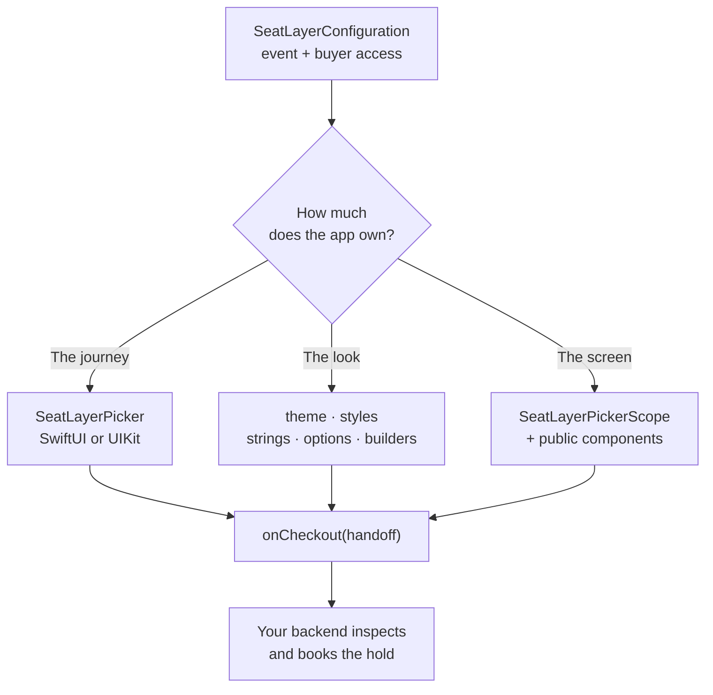

# SeatLayer SDK for iOS: seat map and native seat picker for Swift and SwiftUI

[](https://github.com/seatlayer/seatlayer-ios/actions/workflows/ci.yml)
[](https://github.com/seatlayer/seatlayer-ios/releases/latest)
[](https://swift.org/)
[](https://developer.apple.com/ios/)
[](LICENSE)

> **Latest release: 0.3.4.** Add it with Swift Package Manager from this
> repository's `v0.3.4` tag.

The official SeatLayer iOS seat map SDK for Swift and SwiftUI adds an
interactive seating chart and a ready-made native seat picker to ticketing apps.
Buyers see live availability, pick their own seats or the best available, and
hold them while they check out. The header, filters, seat card, cart, hold
timer, checkout hand-off, errors and navigation are SwiftUI and UIKit views
driven by a typed Swift controller; the venue map inside them is SeatLayer's
own, the same map buyers see on the web. SeatLayer is seating chart and
reserved-seat ticketing software built for venues up to stadium scale.

## What SeatLayer is

SeatLayer is reserved-seat ticketing and seating software: organizers sell with hosted checkout,
a box office, door check-in and season tickets, and platforms add the same seat maps, with 3D
seat views, through the SeatLayer SDK and API. One chart drives the 2D map, the 3D venue and the
view from each seat (3D for venues up to 60,000 seats; the 2D map benchmarked at 200,000 seats).

[Website](https://seatlayer.io/) · [For developers](https://seatlayer.io/developers/) ·
[Season tickets](https://seatlayer.io/season-tickets/) · [Pricing](https://seatlayer.io/pricing/) ·
[Live demo](https://seatlayer.io/demo/)

Season tickets are in the web and server SDKs today, not in this SDK.

## Try it

- [Buyer seat-map demo](https://app.seatlayer.io/demo/play) in your browser, no account needed · [All live demos](https://seatlayer.io/demo/)
- [Quickstart](https://docs.seatlayer.io/start/quickstart/): your first event and keys
- [Swift and SwiftUI seat-map guide](https://docs.seatlayer.io/buyer-sdk/ios/) · [Holds and checkout](https://docs.seatlayer.io/buyer-sdk/holds-and-checkout/) · [SDK catalog](https://docs.seatlayer.io/sdk-catalog.json)
- [Pricing](https://seatlayer.io/pricing/): test mode is free; live, the first 100 sold seats each month are free, then 10¢ down to 5¢ per sold seat, with no subscription, and purchased credits never expire.

Two-step shape: the buyer picks and holds seats in the client with your public key, then your server confirms the booking with your secret key while your platform keeps checkout and its own payment provider.

More from SeatLayer:
[SeatLayer reserved-seating platform](https://seatlayer.io/) ·
[SeatLayer Flutter seat map SDK](https://github.com/seatlayer/seatlayer-flutter) ·
[SeatLayer Android seat map SDK](https://github.com/seatlayer/seatlayer-android) ·
[SeatLayer React Native SDK](https://github.com/seatlayer/seatlayer-react-native) ·
[SeatLayer AI Toolkit](https://github.com/seatlayer/seatlayer-ai-toolkit)

## Install

Swift package (SPM), iOS 15+.

In Xcode, choose **File → Add Package Dependencies** and enter:

```text
https://github.com/seatlayer/seatlayer-ios.git
```

Or declare it explicitly in a manifest:

```swift
dependencies: [
    .package(url: "https://github.com/seatlayer/seatlayer-ios.git", from: "0.3.4")
]
```

Add the `SeatLayer` product to your iOS target, then import it:

```swift
import SeatLayer
```

## Ready-made native picker

SwiftUI receives the complete buyer journey in one view. `onCheckout` is
called once with the typed handoff after the runtime creates or reuses the
authoritative hold:

```swift
import SeatLayer
import SwiftUI

struct TicketPicker: View {
    var body: some View {
        SeatLayerPicker(
            configuration: SeatLayerConfiguration(
                event: "ev_xxx",
                locale: "en",
                currency: "USD"
            ),
            onCheckout: { handoff in
                try await checkoutBackend.begin(with: handoff)
            }
        )
    }
}
```

UIKit hosts the exact same component tree:

```swift
let picker = SeatLayerPickerViewController(
    configuration: SeatLayerConfiguration(event: "ev_xxx"),
    onCheckout: { handoff in
        try await checkoutBackend.begin(with: handoff)
    },
    onClose: { navigationController?.popViewController(animated: true) }
)
```

Use `picker.handleBack()` from UIKit navigation to consume the deterministic
prompt → cart → confirmation → section → venue → host ladder. Call
`updateAppearance(theme:themeMode:strings:styles:)` to change appearance
without remounting the renderer or losing selection/camera state.

`SeatLayerPickerCallbacks` exposes typed ready/load, selection/validity,
hold/expiry, access, unavailable-object, close/error, theme, section, seat,
seat-view, and Continue observations. The original one-argument
`onHoldChanged` callback remains source compatible; `onHoldTransition` adds
the optional hold/handoff lifecycle without changing that closure type.

Applicable Adult/Child/Companion tiers render natively and are applied before
confirmation, with the authoritative tier and price retained through cart and
checkout. In 3D, native controls let the buyer step to the previous or next seat
in the row, look around the view from a seat, and go back to the overview or the
map without confirming the seat. They appear when the event's map supports them.

**Prepare the picker in advance (optional).** Call `SeatLayerPicker.prewarm()`
before you navigate to the picker. It holds no event data or credentials and is
used by the next picker that opens.

```swift
Task { try await SeatLayerPicker.prewarm() }
```

**Stay current when the buyer returns.** The ready SwiftUI picker observes
`scenePhase`; the ready UIKit host observes application notifications. On
foreground they report lifecycle state to the runtime, consume any hold-lapse
or lost-inventory outcome, optionally request fresh availability, and then
synchronize the authoritative snapshot before new buyer actions.

`SeatLayerPickerOptions(refreshOnResume: false)` skips the optional explicit
availability request; runtime lifecycle truth is still consumed.
`announceHoldLapse: false` keeps reconciliation but leaves the visible lapse
message to the host. A custom host can call `controller.lifecycle`,
`controller.refreshAvailability()`, and `controller.synchronize()` directly.

See [Native picker integration](Docs/native-picker.md) and
[security and hold ownership](Docs/native-picker-security.md).

## Works as a native picker

**Every buyer control is native SwiftUI or UIKit.** The seat map itself (venue,
seats, labels, the 3D scene and the view from a seat) is the SeatLayer map from
the web, shown inside your app. The SDK draws the header, price and floor rails,
map controls, seat decisions, cart, hold timer, checkout button, loading and
error states, and accessibility labels. Each picker has one map, so changing the
native look never reloads the map or loses the buyer's position, selection or
hold.

The three supported integration levels are a ladder. Customization keeps the
ready flow; composition keeps the controller, runtime truth, and checkout
contract:

| Level | You want | You write | You keep |
| --- | --- | --- | --- |
| **1** | The complete buyer flow | `SeatLayerPicker` or `SeatLayerPickerViewController` | Native layout, states, holds, and checkout |
| **2** | The flow in your brand and words | Theme, styles, strings, options, or builders | Canonical layout and behavior |
| **3** | Your own screen | `SeatLayerPickerScope` plus public components | Runtime snapshots, typed actions, holds, and handoff |



## Customize the picker

Four public layers change presentation without rebuilding inventory or hold
behavior.

**Colors: a semantic theme.** Native chrome and the renderer receive the same
approved roles, and `.auto` tracks the current iOS color scheme without
remounting:

```swift
let theme = SeatLayerPickerTheme(
    background: "#0F1522",
    surface: "#1A2234",
    text: "#EEF1F8",
    accent: "#FF6584",
    onAccent: "#111827",
    map: SeatLayerPickerMapTheme(
        background: "#0F1522",
        rowLabelColor: "#D7DEEA",
        textColor: "#EEF1F8",
        selectionColor: "#FF6584"
    )
)
```

**One surface: a typed style slot.** A style changes appearance, not ownership
or inventory truth:

```swift
var styles = SeatLayerPickerStyles()
styles[.checkoutBar] = SeatLayerPickerPartStyle(
    background: "#FF6584",
    cornerRadius: 18,
    horizontalPadding: 12,
    verticalPadding: 8
)
```

**Visibility and words: options and strings.** Chrome gates remove optional
default parts, while the 37 bundled locale dictionaries resolve exact BCP-47,
then language, then English:

```swift
let options = SeatLayerPickerOptions(
    chrome: SeatLayerPickerChromeOptions(floorStrip: false)
)
let strings = SeatLayerPickerStrings(
    overrides: [
        SeatLayerPickerStringKey.continueWord.rawValue: "Review order"
    ],
    localeIdentifier: "fr-FR"
)
```

**One whole part: a builder.** Each builder receives the live snapshot,
controller, presentation state, style, and the canonical `defaultContent`:

```swift
var builders = SeatLayerPickerBuilders()
builders.header = { context in
    AnyView(
        context.defaultContent
            .background(.ultraThinMaterial)
    )
}
```

Missing or throwing builders fall back to the canonical component. Test Mode
and `SeatLayerPickerAttribution` intentionally have no builder slot. Test Mode
follows runtime event truth. Attribution appears at bottom-right only when
`snapshot.branding.attributionRequired` is true. The legacy
`SeatLayerPickerChromeOptions.attribution` property remains for source
compatibility but is not an authority in either direction.

Pass `theme`, `themeMode`, `styles`, `strings`, `options`, and `builders` to
`SeatLayerPicker`; UIKit can apply theme/string/style changes in place with
`updateAppearance(theme:themeMode:strings:styles:)`.

## Build your own native picker

`SeatLayerPickerScope` gives a custom SwiftUI tree one controller, one
presentation model, and one renderer session. Use `SeatLayerPickerMap` for the
map and any of the public native components around it:

```swift
let options = SeatLayerPickerOptions(confirmSelection: true)

SeatLayerPickerScope(options: options) { controller in
    ZStack {
        SeatLayerPickerMap(
            configuration: SeatLayerConfiguration(event: "ev_xxx"),
            options: options,
            controller: controller
        )
        VStack {
            SeatLayerPickerHeader()
            SeatLayerPickerPriceLegend()
            HStack {
                SeatLayerPickerTestModeIndicator()
                Spacer()
            }
            Spacer()
            HStack {
                Spacer()
                SeatLayerPickerAttribution()
            }
            SeatLayerPickerDockBar()
            SeatLayerPickerCartList()
        }
    }
}
```

Callbacks observe rather than own the flow. `SeatLayerPickerCallbacks` covers
ready/load, selection and validity, holds and expiry, access failures,
unavailable selected objects, theme, section, seat, seat-view, close/error,
and Continue. The controller exposes typed semantic actions such as
`focusSection`, `overview`, `setFloor`, `setCategoryFilter`,
`refreshAvailability`, and `checkout`; custom UI never talks to the map directly.

`SeatLayerPickerChromeOptions` keeps the original Boolean `overview`, `zoom`,
and `colorblind` master switches. Dense phone layouts keep those actions in
native sheets by default; enable `phoneOverview`, `phoneZoom`, or
`phoneColorblind` to duplicate an enabled master action directly on the map.

UIKit apps that own all chrome use `SeatLayerPickerMapView` or
`SeatLayerPickerMapViewController`, observe `pickerController.snapshot`, and
call the controller's typed semantic actions. Never create a second map for
the same scope. They also own truthful Test Mode presentation and must render
bottom-right attribution exactly when
`snapshot.branding.attributionRequired == true`.

## Native component catalogue

Every default component works inside `SeatLayerPickerScope`; the ready picker
is composed from the same public surface.

| Part | Public default component | Responsibility |
| --- | --- | --- |
| `header` | `SeatLayerPickerHeader` | Event identity, active hold, close |
| `legend` | `SeatLayerPickerPriceLegend` | Runtime price/category filters |
| `floorSelector` | `SeatLayerPickerFloorSelector` | Wide floor selection |
| `floorStrip` | `SeatLayerPickerFloorStrip` | Compact floor navigation |
| `sectionNavigator` | `SeatLayerPickerSectionNavigator` | Section context and stepping |
| `dockBar` | `SeatLayerPickerDockBar` | Focused section and cart entry |
| `accessibilityFilters` | `SeatLayerPickerAccessibilityFilters` | Runtime-authored access needs |
| `map` | `SeatLayerPickerMap` | The single renderer-owned venue surface |
| `mapControls` | `SeatLayerPickerMapControls` | Fit, overview, zoom, access, Map/3D |
| `bestAvailable` | `SeatLayerBestSeatsForm` | Quantity/category/zone request |
| `seatConfirmation` | `SeatLayerPickerSeatConfirmation` | Wide seat/tier decision |
| `confirmCard` | `SeatLayerConfirmCard` | Compact seat/tier decision |
| `generalAdmissionPrompt` | `SeatLayerPickerGeneralAdmissionPrompt` | GA quantity decision |
| `tablePrompt` | `SeatLayerPickerTablePrompt` | Variable-table quantity decision |
| `cartList` | `SeatLayerPickerCartList` | Confirmed lines and removal |
| `cartSheet` | `SeatLayerPickerCartSheet` | Expandable compact cart |
| `venue3D` | `SeatLayerVenue3D` | Runtime-authored 3D navigation chrome |
| `seatViewChrome` | `SeatLayerSeatViewChrome` | Panorama caption and inspection chrome |
| `holdCountdown` | `SeatLayerPickerHoldCountdown` | Snapshot-derived expiry |
| `holdLapse` | `SeatLayerHoldLapseNotice` | Recoverable foreground lapse |
| `actionError` | `SeatLayerPickerActionError` | In-context retryable action error |
| `checkoutBar` | `SeatLayerPickerCheckoutBar` | Quantity, total, Continue |
| `loading` | `SeatLayerPickerLoadingView` | Pre-ready progress |
| `error` | `SeatLayerPickerErrorView` | Retryable and fatal failures |
| `empty` | `SeatLayerPickerEmptyView` | Empty, sold-out, sales-closed truth |

`SeatLayerPickerTestModeIndicator` and `SeatLayerPickerAttribution` are public
truth components outside the 25 replaceable parts. The attribution uses the
shared three-bar mark and occupies the safe bottom-right location when the API
requires it; when the API disables it, the adjacent controls reclaim that
space.

The picker accepts only newer revisions from its active runtime session,
serializes inventory-changing actions, and joins repeated checkout taps into
one flight. Private buyer tokens remain in memory and never enter an ordinary
snapshot.

## Raw map quick start

`SeatLayerView` is the map alone, with the original chart commands that match
the web `SeatingChart` one to one:

```swift
let map = SeatLayerView()
map.delegate = self

var config = SeatLayerConfiguration(event: "ev_xxx", currency: "USD")
config.apiBase = "https://api.seatlayer.io"

let info = try await map.load(config)
if case .test = info.mode { showTestBadge() }   // books no real inventory

let hold = try await map.hold()
```

For private channel inventory, mint short-lived sessions on your backend for
the exact allowed origin `https://cdn.seatlayer.io` and provide renewals in
memory:

```swift
config.buyerAccessTokenProvider = { context in
    try await buyerBackend.mintSeatLayerAccess(reason: context.reason)
}
```

Give `SeatLayerView` an explicit height or make it full-screen.

## Security boundary

The iOS app **selects and holds** inventory. Your trusted backend **inspects and
books** the hold after payment or order validation.

- Never ship a SeatLayer secret key in the app binary or in any app configuration.
- Treat the checkout handoff as opaque client-to-backend data. Do not log,
  display, persist, or place its `holdId` in analytics.
- Calculate the charge from server-inspected hold items, not app input.
- Reuse your stable order id as `bookingRef` for safe booking retries.

The native picker keeps buyer credentials in memory only, keeps no session data
after it closes, and accepts messages only from the SeatLayer map. If your
checkout callback throws, the picker rejects that exact hand-off and keeps the
buyer in the picker.

Ordinary picker snapshots deliberately omit the opaque `holdId`; only
`SeatLayerPickerCheckoutHandoff` crosses that capability boundary. Before a
successful handoff the picker owns the hold and close may release it. After the
host accepts the handoff, close preserves it and the host owns booking,
rejection/release, or expiry. `initialHoldId` restores a host-owned hold;
`readOnly: true` refuses inventory mutation in the controller and runtime, not
only in hidden UI.

Continue with
[seat holds and secure server-side checkout](https://docs.seatlayer.io/buyer-sdk/holds-and-checkout/)
before connecting payment and booking.

## Layout requirement

**The map must be a fixed-height or full-screen box.** Do not put it inside a
`UIScrollView`, `List`, or SwiftUI `ScrollView`. The canvas consumes pan and
pinch to drive its own zoom, so an enclosing scroll view and the map fight over
every gesture and neither behaves. Give it a definite frame.

The SDK already turns off the scrolling, bounce, double-tap zoom, long-press
callout and text selection that would fight the map's own gestures.

## Raw chart API

`hold` · `resumeHold` · `extendHold` · `release` · `releaseLabels` ·
`bestAvailable` · `holdGA` · `setSeatTier` · `getSelection` · `getCurrentHold` ·
`selectObjects` · `deselectObjects` · `clearSelection` · `selectCategories` ·
`deselectCategories` · `setSelectableObjects` · `setMaxSelection` ·
`getSelectionValidity` · `refreshAccess` · `getGAAreas` · `getFloors` ·
`setFloor` · `setColorblindSafe` · `setViewMode` · `getViewMode` · `zoomIn` ·
`zoomOut` · `zoomToFit` · `destroy`. All are
`async throws`, all named to match the web `SeatingChart` so the two SDKs read
as one product.

Events reach `SeatLayerViewDelegate`, which has a no-op default for every
method: `seatLayerViewDidBecomeReady`, `selectionDidChange`,
`selectionValidityDidChange`, `selectionDidBecomeValid`,
`selectionDidBecomeInvalid`, `didReachSelectionLimit`, `buyerAccessDidExpire`,
`buyerAccessBecameUnavailable`, `selectedObjectsBecameUnavailable`,
`holdDidChange`, `holdWasRestored`, `seatLayerViewHoldDidExpire`, `didFailWith`,
`didReceiveHint`, `didTapGAArea`, `seatHoverDidChange`, `didTapFloor`, plus
`didReceiveUnknownEvent` for anything a newer map version adds. Most are
argument labels of `seatLayerView(_:...)`, for example
`seatLayerView(_:selectionDidChange:)`.

## Forward compatibility

Apps built against an older SDK keep working when the SeatLayer map adds new
values. Every enum the SDK decodes has an `unknown(String)` case, and unknown
fields are ignored. Error `code` is an open string set, so API codes like
`sold_out` pass through, and an unknown command returns `unsupported_command`
instead of crashing. `BundleInfo.supports(command:)` lets you hide UI that an
older map version lacks.

## Differences from the web SDK

The Swift API matches the web `SeatingChart` one to one. Two things differ on
iOS: a command that gets no answer within 15 seconds fails with a timeout error
(a late answer is dropped), and the hover tooltip is off by default on touch
screens, so draw your own seat sheet from `seatHoverDidChange`. An app built against an older SDK keeps working when the map gains new events: an unknown event reaches
`seatLayerView(_:didReceiveUnknownEvent:payload:)` and is otherwise safe to ignore.

## Run the example app

`Example/SeatLayerDemo.xcodeproj` is a UIKit host for the ready-made native
picker. Set `SEATLAYER_EVENT_KEY` in the scheme's **Run → Arguments →
Environment Variables** to an authorized test event. Optional
`SEATLAYER_API_BASE`, `SEATLAYER_DEMO_THEME`, `SEATLAYER_DEMO_LOCALE`,
`SEATLAYER_DEMO_WIDE` and `SEATLAYER_PREWARM` values demonstrate the public
configuration, adaptive layout, theme, locale and `prewarm()` APIs.
Never commit credentials or customer event identifiers to the shared scheme.

To build and test the package itself, see [CONTRIBUTING.md](CONTRIBUTING.md).

## Frequently asked questions

### How do I add a seat map to an iOS app?

Add the Swift package and present `SeatLayerPicker` in SwiftUI or
`SeatLayerPickerViewController` in UIKit. That is the complete buyer flow: live
availability, filters, section/floor navigation, confirmation, cart, holds, 3D inspection and a typed checkout handoff. 3D is offered for venues up to 30,000 seats on phones and 60,000 on desktop by default; set `max3DSeats` to change it. Use
`SeatLayerView` only when the app deliberately owns every buyer control and hold
interaction.

### What is native in the SeatLayer iOS SDK?

Everything around the seat map: the header, filters, seat card, cart, hold timer
and checkout hand-off are SwiftUI and UIKit views, and your code works only with
typed Swift commands, payloads, errors and events. The seat map itself is the
SeatLayer map from the web, shown inside your app, so a seat, its price and its
3D view are the same on iOS, Android, Flutter and the web. 3D is offered for venues up to 30,000 seats on phones and 60,000 on desktop by default; set `max3DSeats` to change it. The API matches the web `SeatingChart` one to one.

### Does it work with SwiftUI?

Yes. Use `SeatLayerPicker` for the complete native flow, `SeatLayerPickerScope`
with the public components for your own layout, or `SeatLayerPickerMap` for the
map alone. Give the map a definite frame and keep it out of a SwiftUI
`ScrollView`, because the map handles its own pan and pinch.

### How does seat booking work in an iOS app?

The app selects inventory and receives a temporary hold; it does not book or
charge inside the picker. Send only the opaque handoff to your authenticated
backend, inspect the hold server-side, calculate the charge from trusted hold
items, process payment, and book with a stable `bookingRef`.

### How do temporary seat holds work?

When a buyer goes to checkout, the SeatLayer picker holds the seats they picked
for that buyer for a set time, which you can change per event, so no other buyer
can take them. A hold that is never booked lapses on its own: the picker tells
the buyer once, and `onHoldExpired` tells your app (`seatLayerViewHoldDidExpire`
on the raw map, where your code calls `hold()` itself). `extendHold` and
`resumeHold` cover longer checkouts and app restarts.

### Can I use my own payment provider?

Yes. Nothing in the app takes a payment. Your server reads the held seats and
their prices, charges through the provider you already use, and books the hold
with a stable booking reference.

### Can I try the SeatLayer iOS SDK without an account?

You can see the SeatLayer picker in the live browser demo with no account, and
the package's own tests run with no account or network. To run the iOS picker on
live seats, create a test event and set its key as `SEATLAYER_EVENT_KEY` in the
example app's scheme. Test mode is free, with no time limit and no card, and it
uses no credits.

### Can I restyle the picker without rebuilding it?

Yes. Use a semantic `SeatLayerPickerTheme`, a per-part
`SeatLayerPickerPartStyle`, chrome/string options, or a whole-part builder.
Those layers retain the canonical layout and buyer flow. Theme changes update
native chrome and renderer roles in place without losing selection or camera
state.

### Can I build a completely different picker layout?

Yes. `SeatLayerPickerScope` plus the public native components is a supported
integration level. Keep exactly one scoped `SeatLayerPickerMap`; the controller
continues to own snapshots, typed actions, holds, and checkout.

### Does the picker support light and dark mode?

Yes. `.auto` follows the live iOS color scheme and updates both native chrome
and approved renderer color roles without remounting. `.light` and `.dark` pin
one side explicitly. UIKit can update an already-presented picker with
`updateAppearance(...)`.

### Do buyers see a SeatLayer badge in my app?

No. Buyers see no SeatLayer badge, on any plan, so the picker shows only your
event's name, logo and theme. The test-mode label stays on test events, so
nobody mistakes a test for a live sale.

## Continue your iOS integration

- [Follow the Swift and SwiftUI seat-map guide](https://docs.seatlayer.io/buyer-sdk/ios/)
  for setup, lifecycle, commands, events, and runtime requirements.
- [Use the native picker integration guide](Docs/native-picker.md) for the
  ready SwiftUI/UIKit hosts, customization, public parts, state ownership and
  `prewarm()`.
- [Connect seat holds to secure server-side checkout](https://docs.seatlayer.io/buyer-sdk/holds-and-checkout/)
  without exposing booking credentials in the app.
- [Run the complete checkout example](https://docs.seatlayer.io/examples/complete-checkout/)
  to connect the buyer hold id to payment and idempotent booking.
- [Compare SeatLayer's mobile seat map SDKs](https://docs.seatlayer.io/buyer-sdk/mobile/)
  when choosing between native iOS, Flutter, React Native, and Android.
- [See how the 3D seat map works](https://seatlayer.io/3d-seat-map/): the 3D
  venue and the view from each seat, built from the same chart, on every plan. 3D is offered for venues up to 30,000 seats on phones and 60,000 on desktop by default; set `max3DSeats` to change it.
- [Browse the SeatLayer documentation index](https://docs.seatlayer.io/llms.txt)
  (`llms.txt`) for a compact map of the documentation.

## SeatLayer SDK ecosystem

| Surface | Package or source |
| --- | --- |
| JavaScript | [`@seatlayer/js`](https://www.npmjs.com/package/@seatlayer/js) |
| React | [`@seatlayer/react`](https://www.npmjs.com/package/@seatlayer/react) |
| React Native | [`@seatlayer/react-native`](https://www.npmjs.com/package/@seatlayer/react-native) |
| iOS | [`seatlayer-ios`](https://github.com/seatlayer/seatlayer-ios) (this package) |
| Flutter | [`seatlayer`](https://pub.dev/packages/seatlayer) |
| Android | [`seatlayer-android`](https://github.com/seatlayer/seatlayer-android) |
| Server SDKs | [Node.js, Python, PHP, Ruby, .NET, Java, and Go](https://docs.seatlayer.io/server-sdk/install/) |

## Scale evidence

Benchmarked on public 100,000-, 150,000- and 200,000-seat venue fixtures on 15 September 2026: 200,000 seats chart-ready in 1.95 s, desktop, local production build. Tested at 10,000 simulated concurrent buyers on one 12,000-seat event (18 September 2026): engine-side hold latency p99 9 ms, zero server errors. Method, fixtures and run files: https://github.com/seatlayer/seatlayer-performance. Live 200,000-seat stadium demo: https://app.seatlayer.io/demo/play/century-stadium-200k.

## License

MIT © SeatLayer
